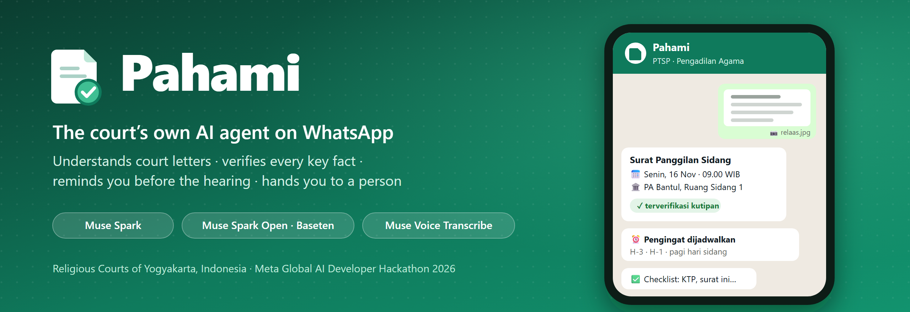

<p align="center">
  
</p>

# Pahami

**A WhatsApp AI agent that helps people with a case at Indonesia’s Religious Courts understand their court letters, keep their hearing dates, and prepare the right documents.**

Built for the [Meta Global AI Developer Hackathon](https://cerebralvalley.ai/e/meta-ai-developer-hackathon) (Oct 26 – Nov 4, 2026) · Track: Indie Developer · Theme: *Build for Your World*

> ⚠️ **Hackathon disclosure:** Everything in this repository was built from scratch during the hackathon building period (Oct 27 – Nov 4, 2026). It is not derived from any existing codebase. See [What was built during the hackathon](#what-was-built-during-the-hackathon) and the dated [CHANGELOG](CHANGELOG.md).

- 🎥 **Demo video:** *([link](https://youtu.be/jc73g726rms))*
- 🧪 **Try it in about 5 minutes:** [install it step by step](#install-and-try-it-step-by-step) with Docker and one Meta API key, then use the WhatsApp simulator in your browser.
- 🔀 **Two Meta models, one switch:** [Muse Spark vs Muse Spark Open in Pahami](#muse-spark-vs-muse-spark-open-in-pahami).

---

## The problem

Every day at the Religious Courts in Yogyakarta, people walk into the service desk holding a summons, a lawsuit or a verdict they do not understand. Most of them are handling a divorce, inheritance or marriage case **without a lawyer**. They do not know what the document means, what they must do next, when the hearing is, or which papers to bring. Missing a single hearing can cost them their case.

I work at the Religious High Court of Yogyakarta and see this firsthand. Pahami (Indonesian for *“understand”*) is my attempt to fix it, on the app every litigant already has: WhatsApp.

## What Pahami does

A litigant sends a **photo, PDF or voice note** to Pahami on WhatsApp. Pahami then acts on it:

1. **Reads the document** directly with a multimodal model, including tilted phone photos of paper (no OCR step).
2. **Checks the facts it read**: every key fact must come with an exact quote from the document, and plain code verifies it (see [Trust](#trust-every-fact-is-tied-to-a-quote)).
3. **Explains it in plain Indonesian**: what the letter is, what it means for you, what to do next, and what happens if you ignore it.
4. **Schedules WhatsApp reminders** for the hearing: 3 days before, the day before and the morning of. Only verified dates are used; an uncertain date is confirmed with the user first.
5. **Builds a checklist** of what to bring and prepare, for the case type and the user’s role in the case.
6. **Answers follow-up questions**, typed or spoken, with the document and the conversation as context.
7. **Routes to the right court** (one of the six Religious Courts in Yogyakarta, with phone number and the PTSP Online service), and **hands to a human officer** what it must not answer: outcome predictions, strategy, drafting. The user can type `ringkasan` for a summary to show the officer.

No app to install, no account to create. Pahami explains court procedure; it does **not** give legal advice. Every explanation says so and points to the court service desk.

**An agent, not a document chatbot.** One photo sets off a chain of steps: read and classify, verify the facts in code, explain, build a checklist, schedule three reminders, and later send them from a scheduler. State lives in the database (users, documents, messages, reminders), so the conversation continues across days. Commands (`jadwal`, `checklist`, `stop`, `pengadilan`, `bantuan`, `ringkasan`) act on that state, and out-of-scope questions are handed to a person and logged.

## Why not just ask Meta AI in WhatsApp?

Meta AI in WhatsApp is a general assistant: you ask, it answers. Pahami uses the same family of models (Muse Spark), but as **the court’s own agent** with a narrow job, the court’s data and rules, and the ability to act over time.

| | General assistant in WhatsApp | Pahami |
|---|---|---|
| **Who runs it** | Meta, for everyone | The court, on its own WhatsApp number (via Fonnte) |
| **Knowledge** | General knowledge | The six Religious Courts in Yogyakarta (address, phone, PTSP Online). The court’s case types and checklists, which court staff can edit in one file |
| **Facts from the letter** | Taken from the model’s answer | Every key fact needs an exact quote from the document. Plain code checks it: a real date, a matching case-number format, a known court, the quote present in the PDF. An uncertain date is confirmed with the user before it is used |
| **Acting over time** | Answers when you write | **Writes first**: reminders 3 days before, the day before and the morning of the hearing, sent by a scheduler |
| **Memory of the case** | The chat | The document analysis, hearing date, reminders and conversation, stored per user and used for follow-up questions |
| **Limits** | General safety rules | Court rules, enforced in the prompts and code: no outcome predictions, strategy or drafting. Such questions go to a human officer, with a summary to show them, and the hand-off is logged |
| **Oversight** | None for the court | `/admin`: documents read, questions handed to the desk, reminders, and every model call with tokens and latency |
| **Data** | Processed by Meta’s consumer assistant | The court decides: Meta Model API, or the **open-weight** Muse Spark Open (Baseten today; self-hosting inside a court network is possible). Media are deleted after 7 days |

In short, a general assistant can explain a letter if you ask the right question. Pahami makes sure the hearing date is right, reminds you before it, tells you what to bring for *your* case at *your* court, and knows when to hand you to a person.

---

## Install and try it (step by step)

Judges do not need a WhatsApp number or a Fonnte account. The **WhatsApp simulator** in the browser runs the same agent code as real WhatsApp.

### 1. What you need

- **Docker** with Docker Compose v2: [Docker Desktop](https://www.docker.com/products/docker-desktop/) on Windows or macOS, or Docker Engine on Linux. Start it before step 4.
- **git**.
- A **Meta Model API key** (`META_API_KEY`). This is the only required key.
- Optional: a **Baseten API key** (`BASETEN_API_KEY`) to try the open-weight model, Muse Spark Open.
- Free ports: **8090** (web) and **3390** (database, local only).

### 2. Get the code

```bash
git clone https://github.com/rynclick/Pahami
cd Pahami
```

### 3. Create `.env` and add your key

```bash
cp env.example .env
```

(Windows PowerShell: `Copy-Item env.example .env`.) Open `.env` in a text editor and fill in:

```ini
META_API_KEY = your-meta-key
# optional, for Muse Spark Open:
BASETEN_API_KEY = your-baseten-key
```

Leave everything else as it is. The database settings already match `docker-compose.yml`.

Only have a Baseten key? Set `MODEL_PROVIDER = baseten` instead. Everything works except voice notes (see [the comparison](#muse-spark-vs-muse-spark-open-in-pahami)).

### 4. Start it

```bash
docker compose up -d --build
```

The first start builds the image, runs `composer install` and creates the database tables by itself. This takes about 1–3 minutes. Follow it with:

```bash
docker logs -f pahami-app
```

It is ready when the log shows `Migrations complete.` and then Apache `resuming normal operations`. (The `AH00558 … ServerName` warning is harmless.) Press Ctrl+C to stop following the log; the app keeps running.

Check that three containers are up (`pahami-app`, `pahami-db`, `pahami-scheduler`):

```bash
docker compose ps
```

Optional: check your key with one real request:

```bash
docker exec pahami-app php spark model:ping meta       # or: baseten
```

### 5. Open the WhatsApp simulator

Open **http://localhost:8090** and choose **English** on the language page. The replies stay in Indonesian (the language of the people Pahami serves), with an English translation under each one.

### 6. A 5-minute walkthrough

1. **Send a letter.** Click **📄 Send a sample summons (synthetic)**. It is a freshly drawn summons with fictional parties and a hearing 10 days from today. In about 10–15 seconds Pahami replies with the explanation, a checklist and the reminders it promises.
2. **See what the agent did.** The right-hand panel shows the **three reminders it scheduled** and **every live model call** (provider, model, tokens, latency).
3. **Use the commands.** Tap the chips `jadwal` (schedule), `checklist` (what to bring) and `pengadilan` (court contact).
4. **Ask a follow-up question.** Tap *Apa itu relaas?* (“What is a relaas?”) or type your own question, in Indonesian or English. Pahami answers from the document it just read.
5. **Ask something it must not answer.** Tap *Apakah saya akan menang?* (“Will I win?”). Pahami hands it to the court service desk instead of guessing. Then tap `ringkasan` for the summary to show the officer.
6. **Get a reminder now.** Click **⏩ Deliver the next reminder now**. It goes through the same sender the scheduler uses every 5 minutes.
7. **Send a voice note** (Meta key needed): click 🎙️, allow the microphone, and ask a question.
8. **Switch the model.** At the top, pick **Muse Spark Open — Baseten** (Baseten key needed), click **Start over**, and send the sample summons again. Compare the model calls in the side panel.
9. **Look at the facts check.** Open **http://localhost:8090/demo**, upload a published verdict PDF ([download one here](#documents-to-try)) or the sample summons, and see the Verifier table: each key fact, its quote, and whether code accepted it.
10. **The staff view.** Open **http://localhost:8090/admin** and pick the **Simulator** tab: documents read, questions handed to the desk, reminders and model usage.

### 7. Stop or reset

```bash
docker compose down        # stop (data is kept)
docker compose down -v     # stop and delete the database
```

To clear all demo data but keep the stack running: `docker exec -it pahami-app php spark demo:reset`.

### Troubleshooting

- **Port 8090 already in use:** start with `PAHAMI_HTTP_PORT=8091 docker compose up -d` and set `app.baseURL = 'http://localhost:8091/'` in `.env`. For the database port use `PAHAMI_DB_PORT`.
- **A reply says the model is unavailable:** check the key in `.env`, then `docker compose restart app`. The error of every failed call is shown on `/admin` under model usage.
- **The page does not load right after starting:** the first `composer install` is still running; wait for it in `docker logs -f pahami-app`.

### Documents to try

- **A summons (*relaas panggilan*): already in the app.** Click **📄 Send a sample summons (synthetic)** in the simulator. To upload it yourself on `/demo` or with 📎, download it from **http://localhost:8090/demo/sample**. The parties are fictional, and the hearing is always 10 days from today, so the reminders are ahead.
- **A verdict (*putusan*): a published PDF from the Supreme Court’s decision directory.**
  1. Open the Religious High Court of Yogyakarta’s page: **[putusan3.mahkamahagung.go.id/pengadilan/profil/pengadilan/pta-yogyakarta.html](https://putusan3.mahkamahagung.go.id/pengadilan/profil/pengadilan/pta-yogyakarta.html)**.
  2. Open any verdict in the list and download its **PDF**.
  3. Send it to Pahami: 📎 in the simulator, or upload it on `/demo` to see the Verifier table.

  Names in these published verdicts are already anonymized by the court. Verdicts from the five first-instance courts in Yogyakarta (PA Yogyakarta, Sleman, Bantul, Wates, Wonosari) work the same way. Verdicts from courts outside Yogyakarta are read too, but the court field is marked uncertain because Pahami only has contacts for the six Yogyakarta courts.

---

## How it uses Meta’s models

| Task | Model |
|---|---|
| Reading photos and PDFs of court documents into a strict JSON schema; follow-up Q&A; English translations on the web pages | **Muse Spark** (`muse-spark-1.3`) via the Meta Model API, **or** **Muse Spark Open** (`meta-models/muse-spark-open-1026`, open-weight) via Baseten |
| Voice notes from WhatsApp (Ogg/Opus → WAV with ffmpeg) | **Muse Voice Transcribe** (`muse-voice-transcribe-1.0`) via the Meta Model API, with Indonesian court vocabulary as keywords |

Document reading uses `reasoning_effort: low` with a `json_schema` response format; follow-up answers use `medium`. All calls go through one `ModelClient` with a timeout, one retry on 429/5xx honoring `Retry-After`, and a row in `model_calls` for every call (tokens, latency, errors).

### Muse Spark vs Muse Spark Open in Pahami

Pahami runs the **whole agent** on either model. The prompts, JSON schema, Verifier, reminders, checklists and escalation are the same code. What differs is where the model runs and what input it accepts, and Pahami adapts to that:

| | **Muse Spark** (`muse-spark-1.3`) | **Muse Spark Open** (`meta-models/muse-spark-open-1026`) |
|---|---|---|
| **What it is** | Meta’s hosted model, through the Meta Model API | Meta’s **open-weight** model, here served by Baseten |
| **Where court data goes** | Meta’s API | Baseten today. Because the weights are open, a court could run it **on its own servers**, so documents never leave the court network |
| **Photos** | Sent as images | Sent as images (same) |
| **PDFs** | Sent as a PDF file. Meta renders at most 50 pages, so Pahami first cuts a verdict down to the pages that matter (opening page, *duduk perkara*, *petitum*, *rekonvensi*, *pertimbangan hukum*, *amar*). A 68-page verdict went from 132,760 to 31,112 tokens, and its *amar* on page 67 was read correctly | **No PDF input** (HTTP 400) and **at most 8 images** per request. Pahami renders the selected pages to PNG and keeps the 8 most important (first page and *amar* first). The same 68-page verdict was read correctly with ~11,000 tokens in 18 s |
| **Voice notes** | Muse Voice Transcribe | Baseten has no transcription endpoint, so voice always uses Muse Voice Transcribe on the Meta API. Without a Meta key, a voice note gets a polite “please type your question” |
| **Structured output** | `json_schema` + `reasoning_effort` | Same (verified on Baseten) |
| **Measured speed** | Document call: 15 s on average (summons photo ~2,700 prompt tokens; 14-page verdict PDF ~38,000) | Document call: 23 s on average (summons 11 s; a 15-page verdict 53 s). Follow-up answers 3–5 s |
| **Quality seen in testing** | Every key field verified on photos and verdicts | Key fields verified on the summons and verdicts. Once it chose a less precise document type (`pemberitahuan` instead of `relaas_panggilan`); the verified facts were not affected |
| **Best for** | The default: fastest, reads long PDFs in one call, voice notes | Courts that must keep data under their own control, or want to self-host |

**Why the swap is safe.** The facts that matter (case number, court, hearing date and time, the recipient’s role) are checked by the same plain-code `Verifier` whichever model read them. A weaker read shows up as an *uncertain* field and a question to the user, not as a wrong reminder.

**How to switch:**

- In `.env`: `MODEL_PROVIDER=meta` or `MODEL_PROVIDER=baseten` (then `docker compose restart app`).
- Per session in the simulator: the **Model** menu at the top of `/demo/chat`, or the model choice on `/demo`.
- Mixed: `MODEL_VISION_PROVIDER` sends image/PDF calls to one provider and text calls to the other.
- The provider and model of every call are shown in the simulator’s side panel and on `/admin`.

## Trust: every fact is tied to a quote

Pahami does not take the model’s word for the facts that matter. For the case number, court, hearing date, hearing time and the recipient’s role, the model must also return the **exact text span** from the document (`kutipan`). A deterministic `Verifier` (plain PHP, no model call) then checks:

- **Date:** a real calendar date, **and** it matches the date written in the quote (Indonesian month names supported).
- **Time:** a valid time that matches the quote.
- **Case number:** matches the Religious Court format (`123/Pdt.G/2026/PA.Btl`, or `PTA.Yk` for an appeal) and appears in the quote.
- **Court:** one of the six in Yogyakarta, and agrees with the code in the case number.
- **Quotes in PDFs with a text layer:** **each quote must actually occur in the PDF text**, so a made-up quote cannot back a field. Matching uses 3-word sequences and tolerates the Supreme Court watermark and reading-order differences. On real verdicts, genuine quotes scored 0.80–1.00 and an invented sentence 0.22; the threshold is 0.6. Photos and scanned PDFs have no text layer and skip this check.

Each field ends up `ok`, `tidak_pasti` (uncertain) or `kosong` (not in the document). The confidence level is **computed from these checks**, not from the model’s self-report. Low confidence means a “please re-photo” reply instead of a guess. Only a verified hearing date is used for reminders; an uncertain one is confirmed first (“Balas *ya* atau kirim tanggal yang benar”).

## Architecture

```
WhatsApp ──Fonnte webhook──▶ Webhook\Fonnte ──(answers at once, runs in background)──▶ fonnte:process
Browser  ──/demo/chat──────▶ DemoChat ─────────────────────────────────────────────────┐   │
                                                                                       ▼   ▼
                                                                                InboundHandler
         photo / PDF ─▶ DocumentAnalyzer (Muse Spark / Muse Spark Open, JSON schema) ─▶ Verifier (plain PHP)
                         ─▶ WhatsAppFormatter (explanation, checklist) ─▶ ReminderPlanner (H-3, H-1, H-0)
         voice note  ─▶ Transcriber (Muse Voice Transcribe) ─▶ handled as text
         text        ─▶ commands (jadwal, checklist, stop, ringkasan, …)
                         or ConversationAgent (document + last 10 messages; escalates out-of-scope)
                                                                                       │
                                     replies via FonnteClient (WhatsApp) or SimulatorClient (browser)

scheduler container: reminders:send every 5 min · media:purge --days=7 every hour
```

Main files:

- `app/Services/`: one class per responsibility (`DocumentAnalyzer`, `Verifier`, `ConversationAgent`, `ReminderPlanner`, `ChecklistBuilder`, `CourtDirectory`, `WhatsAppFormatter`, `PdfPageSelector`, `Model/*`, `Fonnte/*`).
- `app/Services/Model/Providers/`: `MetaProvider` and `BasetenProvider` on one OpenAI-compatible base; the Baseten class only declares “no PDF, max 8 images”.
- `app/Prompts/`: the two system prompts.
- `app/Config/Perkara.php`: the 20 Religious Court case types with their checklists, editable in one place.

## Data and privacy

- **Retention.** Uploaded files and WhatsApp media are deleted after 7 days by `php spark media:purge` (the analysis, reminders and transcripts stay).
- **Masked numbers.** Phone numbers are masked on `/admin`.
- **Login.** `/demo` and `/admin` can be put behind a login (`DEMO_PASSWORD`).
- **Webhook secret.** The Fonnte webhook requires a secret in its URL, and ignores duplicate deliveries and group messages.
- **Test and demo documents** are synthetic, with fictional parties, or **publicly published verdicts** from the Supreme Court’s decision directory. No real case files or personal data are in this repository.
- **Secrets** live only in `.env`, which is never committed.

## Tests, command-line tools and real WhatsApp

**Tests:** `docker exec pahami-app vendor/bin/phpunit`. 186 tests, with all model and WhatsApp calls mocked, so no key is needed. The test database is created automatically.

**Command-line tools** (real calls; run inside the container with `docker exec pahami-app …`):

| Command | What it does |
|---|---|
| `php spark model:ping [meta\|baseten] [--image <path>]` | One request to a provider |
| `php spark document:analyze <path> [--provider baseten]` | Runs the document pipeline on a file; nothing is stored |
| `php spark agent:ask <phone> "<question>"` | A follow-up question as a WhatsApp user |
| `php spark voice:transcribe <path>` | Transcribes an audio file |
| `php spark demo:reset` | Deletes all demo data to start from scratch (asks first; use `docker exec -it`) |

**Real WhatsApp** (optional):

1. Get a [Fonnte](https://fonnte.com) device with a package that sends media links, and set `FONNTE_TOKEN` and `FONNTE_WEBHOOK_SECRET` in `.env`.
2. Start a temporary public HTTPS URL: `docker compose --profile tunnel up -d tunnel`, then find it with `docker logs pahami-tunnel 2>&1 | grep trycloudflare.com`.
3. Set the device webhook to `https://<tunnel-host>/webhook/fonnte?key=<FONNTE_WEBHOOK_SECRET>`.

## What works

Everything below was tested live on Meta and Baseten, and the core logic is covered by tests. WhatsApp was tested end to end on a real Fonnte device: a summons photo is explained in ~10 s, and a verdict PDF in ~20 s.

| Component | Status |
|---|---|
| Document reading (photo/PDF → strict JSON schema, one retry on invalid output) with the deterministic `Verifier` and PDF quote check | ✅ Meta and Baseten |
| Verdict structure: *duduk perkara*, *petitum*, key *menimbang* reasons, every *amar* item, *rekonvensi*, a plain-language glossary of legal terms; verzet / banding explained as information only | ✅ |
| WhatsApp webhook (Fonnte): answers at once, processes in the background, replies via the send API | ✅ Live on WhatsApp |
| Hearing reminders H-3 (09.00), H-1 (16.00) and the morning of (06.00) via `reminders:send` every 5 min; uncertain dates confirmed first | ✅ |
| Checklist per case type (20 types in `app/Config/Perkara.php`) and party role, plus items read from the document | ✅ Base lists awaiting review by court staff |
| Commands `jadwal`, `checklist`, `stop`, `pengadilan`, `bantuan`, `ringkasan` | ✅ |
| Follow-up Q&A from the latest document (last 7 days) and the last 10 messages; out-of-scope questions escalated and logged | ✅ |
| Voice notes: Ogg/Opus → WAV → Muse Voice Transcribe, transcript echoed back (“🎙️ Saya dengar: …”) and handled like text | ✅ Meta only |
| Court directory: six DIY Religious Courts with address, phone, email and the PTSP Online link | ✅ |
| Open-weight path: the whole agent on Muse Spark Open, switchable in `.env` or per session | ✅ |
| WhatsApp simulator `/demo/chat`, document view `/demo`, staff view `/admin`, in Indonesian or English | ✅ |
| Media retention (`media:purge --days=7`, hourly) | ✅ |
| Docker setup from a clean clone with one key (migrations and test database automatic) | ✅ Verified on a fresh clone |

**Not built:** SAM 3.1 stamp/signature detection, Muse Glimmer on Modal, consultation booking, a weekly staff digest (stretch goals), and a public deployment.

## What was built during the hackathon

Everything here: the WhatsApp agent, document pipeline, verifier, prompts, reminder scheduler, checklist logic, simulator, web pages and this README. The [CHANGELOG](CHANGELOG.md) lists the work by date.

For context only: I previously built [PTSP Online](https://ptsp.pta-yogyakarta.go.id), the one-stop service portal for the six Religious Courts in Yogyakarta. Pahami is a **separate, new codebase**. The only link is that Pahami points users to that existing service desk. No code is shared.

## Author

**R. Taufik**, Religious High Court of Yogyakarta, Indonesia · [GitHub](https://github.com/rynclick) · [LinkedIn](https://linkedin.com/in/ryan-taufik-7462a348)

## License

MIT, see [LICENSE](LICENSE).
